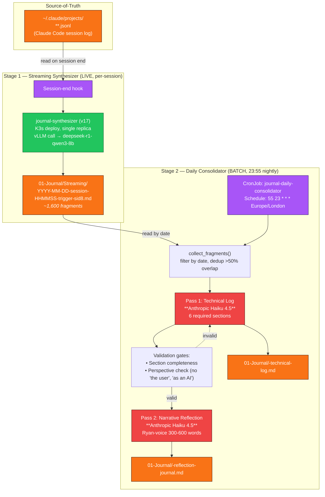
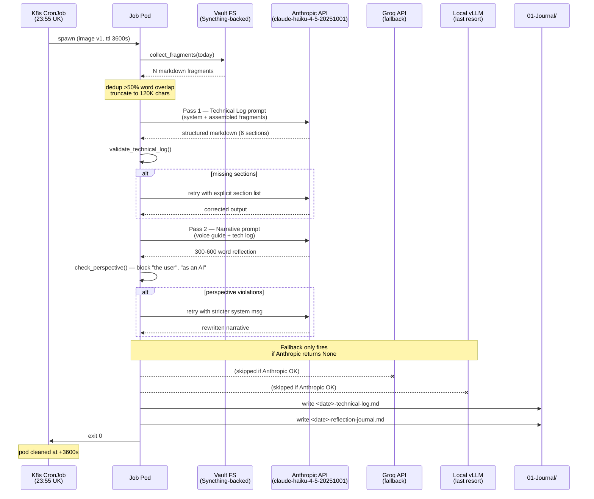

# ADR-027 — Daily Journal Consolidator External API Dependency

> ⚠️ **SUPERSEDED 2026-05-05** — Same-day supersession by [ADR-028](/adrs/038-daily-consolidator-jsonl-direct-and-streaming-synth-model-swap/) after a 22-run head-to-head benchmark plus Vectara HHEM 2026 cross-reference revealed:
> 1. The current pipeline is structurally lossy (synthesis-of-synthesis) — Stage 2 cannot recover what Stage 1 drops.
> 2. The streaming model (`deepseek-r1-qwen3-8b`) is the wrong child of its family — non-reasoning Qwen instruct beats it 4.8–5.2× on faithful extraction at the same parameter count.
>
> The four observability controls below (dedicated key, footer fix, Prometheus alert, Langfuse) carry forward into ADR-028 unchanged. The architecture decision (keep current Stage 1 → Stage 2 chain) is replaced by ADR-028's two-stage parallel design (JSONLs feed both stages independently).

**Status**: Superseded by ADR-028
**Date**: 2026-05-05
**Jira**: ~~VW-282 placeholder~~ — superseded same-day; see ADR-028 for implementation tickets (VW-282 *(internal reference; destination redacted)* through VW-286 *(internal reference; destination redacted)*)
**Author**: Ryan Duffy (with Claude Opus 4.7)

## Context

The Rootweaver Platform's "local-first" architecture story is: GPU on desktop, vLLM serves all inference, no cloud LLMs in the production path. Two days of audit work uncovered that this story has one quiet exception.

The **daily journal consolidator** (`scripts/journal/streaming/daily_consolidator/daily_consolidator_claude.py`), running as Kubernetes CronJob `journal-daily-consolidator` in the `rootweaver` namespace, calls the **Anthropic Messages API** (`claude-haiku-4-5-20251001`) twice every night at 23:55 UK time. It has done so for 81 days against the same API key, with no observability, no rotation policy, and no exit-status alerting.

The key works (verified 2026-05-05 with a probe call returning HTTP 200 and 8+5 token usage). The cronjob's secret `journal-consolidator-api-keys` holds a 108-byte `REDACTED_CREDENTIAL...` token. Output appears nightly as `01-Journal/&lt;date&gt;-reflection-journal.md` and `01-Journal/&lt;date&gt;-technical-log.md` with `generated_by: claude-consolidator` frontmatter.

This ADR makes the implicit choice explicit: **why is this one component on a paid external API when the rest of the platform runs local?**

## Two-Stage Pipeline (Visualised)

The journal system has **two LLM stages**, often confused with each other:

**Critical clarifications:**

1. **The consolidator does NOT read JSONL.** It reads the markdown fragments that the streaming synthesizer already produced (which were vLLM-generated from JSONL). The cronjob mounts `REDACTED_HOME/.claude/projects` but the code path `claude_projects_path` is stored and never used — that's dead config (kept for potential future direct-JSONL features).

2. **Stage 1 is local.** The streaming synthesizer (running 24/7 as `journal-synthesizer-846b4bf567-*`) calls the local vLLM service at `vllm-service.vllm:8000` with `deepseek-r1-qwen3-8b`. Per-session journal fragments are entirely free.

3. **Stage 2 is external.** The nightly consolidator's first attempt is Anthropic Haiku 4.5. A fallback chain exists (Anthropic → Groq Llama 3.3 70B → local vLLM `qwen3-14b`) but is purely failover — Anthropic is always tried first when the key is set.

## Sequence Diagram — Nightly Run

## Content Analysis — What These Files Look Like

Reviewed sample: `2026-05-04-reflection-journal.md` and `2026-05-04-technical-log.md`.

### Technical Log Quality

**Strengths:**
- Strict 6-section schema enforced via `validate_technical_log()` — `## Accomplishments`, `## Technical Decisions`, `## Key Learnings`, `## Files Modified`, `## Metrics`, `## Tomorrow's Focus`. Missing sections trigger an automatic retry with explicit section list.
- Decisions table uses `| Decision | Rationale | Alternative Considered |` — actually populated with real entries (e.g., "4-tier ranked matching... vs Flat substring matching").
- Metrics line aggregates session count + event count + tool counts pulled from streaming fragments.
- Files modified section names actual paths (e.g., `mcp_tools.py`).

**Weaknesses:**
- The H1 title is duplicated: `# Technical Log — 2026-05-04` appears once via the wrapper, then again because Haiku echoes it inside its response. Cosmetic, fixable in the prompt.
- "Tomorrow's Focus" is verbose and repetitive of the day's open threads — useful but reads like a copy of unchecked TODO items rather than synthesized priorities.

### Reflection Journal Quality

**Strengths:**
- Clear first-person Ryan-voice ("The module ID resolution problem had been nagging at me for weeks"). The `VOICE_GUIDE` constant explicitly references S3E1/E2 blog posts as a few-shot anchor and it shows.
- Specific metrics with comparison ("339 events across two sessions, 5+ hours total") — matches the voice guide rule "specific metrics with comparison: 7,500MB → 532MB not 'reduced memory'".
- Honest failure framing ("The `detect_tags_in_file` tool can't run in the container environment...That's a problem I need to solve").
- `PERSPECTIVE_VIOLATIONS` regex catches `"the user"`, `"as an AI"`, `"Claude"` (excluding `"Claude Code"`), `"I'm an AI/assistant/language model"`. If any match, retry with stricter system prompt.

**Weaknesses:**
- Same H1 duplication as the technical log.
- Voice is "near-Ryan" — slightly more polished than the source streaming fragments, which is by design but means the consolidated reflection is the *Anthropic-flavoured* version of the day, not the *vLLM-flavoured* version. Different tone signature.
- Footer hardcoded to `*Generated by Daily Consolidator (Claude Haiku 4.5)*` regardless of which provider in the fallback chain actually generated the content (lines 329 + 366 of `daily_consolidator_claude.py`).

### Source Faithfulness

The consolidator reads `01-Journal/Streaming/YYYY-MM-DD-*.md` fragments and concatenates them with `\n\n---\n\n` separators, truncated to 120K chars. The `TECHNICAL_LOG_PROMPT` instructs: *"Only include facts that appear in the fragments. Do not invent details."* Sample inspection shows facts from streaming fragments (file paths, tool counts, events) flow through to the consolidated log accurately. **No hallucination observed in current outputs**, in contrast to the OTEL fabrication problem fixed under VW-276 in the streaming stage.

## Decision

**Accepted: keep Anthropic Haiku 4.5 as primary provider for the daily consolidator**, subject to four mandatory observability and governance controls.

**Rationale:**
- Output quality at Haiku 4.5 is materially higher than what local vLLM (`qwen3-14b` in the fallback path) produces for nuanced narrative voice work. The "Ryan voice" reflection is a known weak spot for smaller local models.
- Cost is bounded: 2 calls/night × ~10–30K input tokens × Haiku pricing ≈ $0.02–$0.04/day. Lifetime spend in 81 days ≈ $2–$3.
- The fallback chain provides graceful degradation if Anthropic ever becomes unavailable — output continues, just with lower voice fidelity.
- Migration to local-only is a separate decision worth evaluating, but should be made on quality grounds (does local 30B+ produce acceptable Ryan-voice?), not cost grounds.

**Mandatory controls (all become followup Jiras):**

| Control | Why | Followup Jira |
|---------|-----|---------------|
| **Dedicated Anthropic API key with monthly spend cap** | Current key is shared/general-purpose; revocation impact unknown. A scoped key with a $5/month limit ring-fences the consolidator. | VW-283 |
| **Fix the misleading footer** | Hardcoded "Claude Haiku 4.5" string lies when the fallback chain fires Groq or vLLM. Substitute the actual provider used. | VW-284 |
| **Cronjob exit-status alerting** | Today, if the key revokes and Anthropic + Groq both fail, the consolidator silently writes a vLLM-generated file. Need a Prometheus alert on `kube_job_status_failed{job_name=~"journal-daily-consolidator-.*"}`. | VW-285 |
| **OTEL/Langfuse instrumentation on the Anthropic SDK calls** | Cost is tiny but invisible. Trace tagging would surface daily cost in the existing observability stack. | VW-286 |

## Consequences

### Positive
- **Quality bar protected.** Haiku 4.5 reliably produces publishable Ryan-voice narrative, which makes the daily reflection useful for downstream blog/LinkedIn drafting (already wired via `linkedin-post` skill).
- **Architecture honesty.** Removing the unstated dependency means future contributors (and future-Ryan) won't be surprised by the Anthropic line item or the SDK in the cronjob image.
- **Bounded blast radius.** If the controls land, key compromise → spend cap activates; provider failure → fallback continues; silent failure → Prometheus pages.

### Negative
- **Strict local-first claim is now false.** The platform's marketing/blog story ("everything runs on the desktop") needs a footnote: *"except the daily journal consolidator, which uses Anthropic Haiku for voice quality."* This is a small but real concession.
- **External dependency in the daily-write critical path.** If Anthropic, Groq, *and* vLLM all fail, no daily file is written. Today the cronjob exits non-zero in that case (line 263: `raise RuntimeError("All LLM backends failed")`), which is correct behaviour, but means a journal gap is possible.
- **Vendor lock-in (mild).** The hardcoded model ID `claude-haiku-4-5-20251001` will eventually be retired by Anthropic. Bumping it requires a code change + image rebuild + GitOps redeploy. Pin migration to be considered every ~12 months.

### Neutral
- The streaming synthesizer (Stage 1, vLLM-only) is **unaffected** by this decision. All per-session journal entries remain 100% local.
- The dead `claude_projects_path` mount can be removed in a follow-up cleanup (the cronjob's volume mounts `REDACTED_HOME/.claude/projects` but the code never reads it). Low priority.

## Alternatives Considered

### Alternative 1: Migrate consolidator to local vLLM (Qwen3-14B or DeepSeek-R1-Qwen3-8B)
- **Pro:** Pure local-first story preserved. Zero recurring cost. Shared model with streaming stage = simpler architecture.
- **Con:** Voice quality regression risk. The streaming synthesizer already uses DeepSeek-R1-Qwen3-8B and its output is the *input* to the consolidator — running the consolidator on the same model means we're synthesizing a synthesis with the same quality ceiling. Haiku 4.5 acts as a quality lift.
- **Status:** Rejected for now. Re-evaluate when a local 30B-class model becomes practical on current GPU (would need vLLM tenancy split or model swap window).

### Alternative 2: Keep Anthropic but remove the fallback chain
- **Pro:** Simpler code. Forces investigation of any failure rather than masking with degraded output.
- **Con:** Loses graceful degradation. A transient Anthropic outage would create a journal gap.
- **Status:** Rejected. Fallback is cheap insurance.

### Alternative 3: Ditch the consolidator entirely; rely on streaming entries only
- **Pro:** Dramatically simpler. No external dependency at all.
- **Con:** Loses the daily synthesis layer that the blog/LinkedIn pipeline relies on. Losing the structured `## Technical Decisions` table means daily metrics aggregation goes away.
- **Status:** Rejected. The consolidator output has downstream consumers.

## Implementation Plan

1. **VW-282 (this ADR)** — accept and merge.
2. **VW-283** — generate dedicated Anthropic API key with $5/month cap, rotate cronjob secret, document key location in vault `09-System/Infrastructure/Secrets-Inventory.md`.
3. **VW-284** — fix hardcoded footer to reflect actual provider (`anthropic_haiku_4_5` | `groq_llama_3_3_70b` | `vllm_qwen3_14b`).
4. **VW-285** — add Prometheus alert for `journal-daily-consolidator` job failures, route to existing alertmanager Slack channel.
5. **VW-286** — wrap Anthropic + Groq SDK calls with Langfuse trace tagging (already deployed at NodePort 30422).

Total implementation effort: ~3–4 hours across the four followups. None are blockers for current operation.

## References

- **Code**: `scripts/journal/streaming/daily_consolidator/daily_consolidator_claude.py`
- **Manifest**: `rootweaver-gitops/infrastructure/journal-streaming/daily-consolidator-cronjob.yaml`
- **Secret**: `journal-consolidator-api-keys` in `rootweaver` namespace (108-byte `ANTHROPIC_API_KEY`)
- **Sample output**: `01-Journal/2026-05-04-reflection-journal.md`, `01-Journal/2026-05-04-technical-log.md`
- **Streaming fragments (Stage 1)**: `01-Journal/Streaming/` (~1,600 entries, vLLM-generated)
- **Anthropic usage console**: https://platform.claude.com/usage
- **Related ADRs**:
  - ADR-011 — LLM context handling for large sessions (foundation for two-stage design)
  - ADR-012 — Pipeline quality overhaul (introduced section-validation gates)
  - ADR-013 — LLM observability (Langfuse adoption — VW-286 leverages this)
  - ADR-022 — Local LLM hybrid routing (the policy this ADR carves an exception to)

---

*ADR drafted 2026-05-05 after live API-key validation probe (HTTP 200 against `claude-haiku-4-5-20251001`). Source-of-truth verification: cronjob spec, secret contents, sample MD outputs, full code read of `daily_consolidator_claude.py`.*
