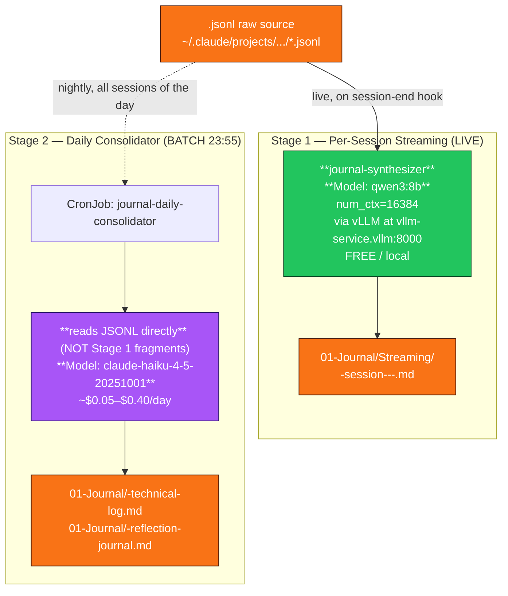

# ADR-028 — Daily Consolidator Reads JSONL Directly + Streaming Synth Model Swap

**Status**: Accepted
**Date**: 2026-05-05
**Supersedes**: [ADR-027](/adrs/037-daily-journal-consolidator-external-api-dependency/) (same-day supersession)
**Primary Jira**: VW-283 *(internal reference; destination redacted)* (consolidator JSONL-direct rewrite)
**Implementation tickets**: VW-282 *(internal reference; destination redacted)*, VW-283 *(internal reference; destination redacted)*, VW-284 *(internal reference; destination redacted)*, VW-285 *(internal reference; destination redacted)*, VW-286 *(internal reference; destination redacted)*
**Author**: Ryan Duffy (with Claude Opus 4.7)
**Decision basis**: 22-run head-to-head benchmark + cross-reference to Vectara HHEM 2026 leaderboard
**Reinforcing evidence (2026-05-06 addendum)**: 28-run cross-workload benchmark (3 workloads × 7 models) confirmed `qwen3:8b ctx=16k` as overall mean leader — wins Journal + Scout outright, ties Phi-4 on SRE within 1 point. **Single-model architecture validated.** See cross-workload sample outputs *(internal reference; not included)* in `09-System/Architecture/Benchmarks/`.

## Why This Supersedes ADR-027

ADR-027 (filed earlier today) accepted the existing daily consolidator design — Anthropic Haiku reading vLLM-summarised markdown fragments — with four observability controls. That decision was made on architectural grounds without empirical model comparison.

In the hours since, a 22-run benchmark across 12 models on the same 2 JSONL sessions, plus the Vectara HHEM 2026 hallucination leaderboard, produced two findings ADR-027 did not have:

1. **The current pipeline is structurally lossy.** Stage 1 (vLLM `deepseek-r1-qwen3-8b`) summarises away the specifics that make journal entries useful 6 months later. Stage 2 (Haiku) cannot recover what Stage 1 dropped — synthesis-of-synthesis bounds the final quality at Stage 1's fidelity ceiling.

2. **The streaming model is the wrong child of its family.** Same parameter count, non-reasoning Qwen instruct beats the R1 reasoning distill **4.8× on faithful extraction** (specificity score 45.5 vs 9.4). And `qwen3:8b` with extended context beats it **5.2×** (48.5 vs 9.4). The current production model is genuinely unfit for this workload — not because it's small, but because it was trained for the wrong task.

ADR-027 framed Haiku as a *quality lift* over local synthesis. The benchmark reframes it as *patching a structurally lossy pipeline*. That changes the right answer for the streaming side.

## Context

The journal system has two LLM stages reading the same fundamental source (Claude Code session JSONLs):

- **Stage 1 (live, per-session)**: produces ~1,600 markdown fragments in `01-Journal/Streaming/` for same-day search and Obsidian browsing.
- **Stage 2 (nightly batch, 23:55 UK)**: produces `01-Journal/&lt;date&gt;-{technical-log,reflection-journal}.md` as the durable end-of-day artefact.

Up to today, both stages were architecturally entangled: Stage 2 read Stage 1's *output* rather than reading the JSONLs directly. This is the root cause of the consolidated daily files losing concrete numbers, dates, file paths, and corrective insights present in the raw transcripts.

Two independent decisions are now ripe:

- **Stage 1**: which model produces the streaming fragments?
- **Stage 2**: what does the consolidator read, and which model produces the daily files?

This ADR settles both.

## Decision

### Specific decisions

1. **Stage 1 streaming synth swaps from `deepseek-r1-qwen3-8b` to `qwen3:8b` with `num_ctx=16384`.**
   Same VRAM footprint (both ~5GB AWQ/GGUF). 5.2× specificity uplift on identical workloads. Schema compliance 12/12 (vs reasoning-leak in 5/5 of prior model's outputs). Free.

2. **Stage 2 daily consolidator re-architects to read JSONL files directly from `/claude-projects` mount (already provisioned but unused).**
   The current `collect_fragments()` call in `daily_consolidator_claude.py` is replaced with `collect_jsonls(target_date)`, reusing existing parser helpers from `journal_synthesizer.py` (`_extract_session_date`, `_count_tools_from_messages`, `_build_jsonl_timeline`).

3. **Stage 2 model remains Anthropic Haiku 4.5 (`claude-haiku-4-5-20251001`).**
   On large inputs (≥189 events / day's worth), best local model retains only 31% of Haiku's specificity. The artefact's six-month-readability requirement is not met by any tested local model at session-aggregate scale. Cost ceiling: $146/year worst case.

4. **Mandatory Ollama / vLLM config standard: `num_ctx >= 16384` for any service in the journal pipeline.**
   The 4096 default cost 18 specificity points (62% relative) on the same model in our benchmark. This is a deployment hazard, not a model issue.

5. **All four ADR-027 observability controls remain in force** (dedicated Anthropic key with $5/month cap, footer-attribution fix, Prometheus alerting on cronjob failure, Langfuse instrumentation). They are independent of the model/path choices and remain mandatory.

## Evidence — 22-Run Benchmark

Same 2 JSONL sessions, identical extraction prompt, 12 models. Scoring on objective specificity (currency amounts × 2 + ISO dates × 2 + natural dates + file paths × 2 + numbered metrics) plus schema compliance (6 required sections) and reasoning-leak detection.

### Mean specificity ranking (best to worst)

| Rank | Model | Spec | % of Haiku | Schema (n=2) | Notes |
|---|---|---|---|---|---|
| 1 | **anthropic-haiku-4-5-20251001** (cloud) | **107.5** | 100% | 12/12 ✅ | reference baseline |
| 2 | **qwen3:8b @ ctx=16384** | **48.5** | **45%** | **12/12** ✅ | only local model passing schema both sessions |
| 3 | qwen2.5:7b | 45.5 | 42% | 6/12 ⚠️ | drifts schema on session 2 |
| 4 | llama3.1:8b | 43.5 | 40% | 9/12 ⚠️ | dark-horse contender |
| 5 | qwen2.5:3b | 38.5 | 36% | 6/12 ⚠️ | punching above weight |
| 6 | qwen3:8b @ ctx=4096 (default) | 30.0 | 28% | 6/12 ⚠️ | 18-point loss vs 16K |
| 7 | qwen2.5-coder:14b-q4 | 28.0 | 26% | 6/6 (n=1) | hung on session 2 — RAM pressure |
| 8 | mistral:7b | 20.0 | 19% | 6/12 ⚠️ | |
| 9 | phi-4 | 19.0 | 18% | 12/12 ✅ | faithful but minimal output (see below) |
| 10 | mistral-nemo:12b | 12.5 | 12% | 0/12 ❌ | drifts heavily |
| 11 | glm-4.7-flash | 0 | 0% | 0/6 | output → `reasoning` field |
| 12 | qwen3.5:9b-q8_0 | 0 | 0% | 0/6 | RAM choke at q8 |
| ref | **deepseek-r1-qwen3-8b** (current production) | **9.4** | **9%** | 12/12 | reasoning leak in 5/5 prior runs; vague |

### Per-session breakdown — the gap shape

| Session | Haiku | qwen3:8b @ ctx=16384 | qwen2.5:7b | llama3.1:8b |
|---|---|---|---|---|
| Small (99 events, ~7K char transcript) | 48 | **46 (96%)** | 12 | 12 |
| Large (189 events, ~12K char transcript) | 167 | 51 (31%) | 79 (47%) | 75 (45%) |

**Key pattern**: qwen3:8b ctx=16K is essentially Haiku-equivalent on per-session inputs (96%) but Haiku pulls away on multi-session aggregates (31%). This validates the two-stage decision: **local for per-session, Haiku for daily aggregate**.

### Vectara HHEM 2026 cross-reference

The Vectara hallucination leaderboard ranks for *minimum hallucination on document summarisation* (different objective than ours, but adjacent):

| Model | Vectara HHEM rate | Our specificity rank | Interpretation |
|---|---|---|---|
| Phi-4 (14B) | **3.7%** ⭐ #1 | 9th (19.0) | **Optimises for "say less, say it correctly"** — minimum hallucination achieved by minimum specificity. Useful but wrong objective for journals. |
| Llama-3.3-70B | 4.1% | (not tested locally — too big) | Strong cloud candidate via Groq/Cerebras. |
| **Qwen3-8B** | 4.8% | **2nd locally (48.5)** | Confirmed match between leaderboards: faithful AND specific. |
| Qwen3-14B | 5.4% | (not tested) | Same family at larger scale. |
| Qwen3-4B | 5.7% | (not tested) | Smaller viable option. |

**Insight**: Vectara's leaderboard is a *necessary but not sufficient* signal. Phi-4's #1 ranking there reflects *low hallucination*, but our benchmark shows the model achieves it via terse output rather than dense faithful extraction. For workloads requiring rich-and-faithful (journals, technical logs), Vectara is a sanity-check filter — exclude high-hallucination models — but the within-cohort ranking should be re-tested on the actual workload.

## Consequences

### Positive

- **Stage 1 quality**: 5.2× specificity uplift on streaming fragments at zero cost or new infrastructure. The same daily journals will have ~5× the concrete numbers, dates, file paths preserved.
- **Stage 2 quality**: removing the synthesis-of-synthesis chain means the consolidated daily files no longer inherit Stage 1's information loss.
- **Architectural clarity**: Stage 1 and Stage 2 are now explicitly independent consumers of the same source (JSONLs), not a chain. Each can be optimised separately. Failure of one does not silently degrade the other.
- **Cost discipline maintained**: Stage 2 cost ceiling stays at the ADR-027 figure (~$18–$146/year). Stage 1 stays free.
- **Honest local-first story**: the "local-first" claim now applies cleanly to Stage 1 (per-session, high-throughput, free, local). The cloud dependency is isolated to Stage 2 (one batch a day, durable artefact, cost-bounded). Easy to explain, easy to reason about.

### Negative

- **One-time migration effort**: ~3.5 hours total across three changes (streaming-synth model swap + image rebuild, consolidator code rewrite to read JSONL, num_ctx config standard rollout). Plus 1 night of shadow-mode validation before cutover.
- **Stage 1 latency increase**: qwen3:8b with num_ctx=16384 is slower than the current model on identical inputs (longer effective context window means more attention compute). Expected per-session synthesis time goes from ~10s to ~30–60s. Acceptable for the streaming workload (still < 1 minute end-to-end for session_complete trigger).
- **Vendor lock-in (mild, unchanged from ADR-027)**: hardcoded model ID `claude-haiku-4-5-20251001` will eventually be retired. Pin migration to be considered every ~12 months.

### Neutral

- The fallback chain in `daily_consolidator_claude.py` (Anthropic → Groq → vLLM) remains in place as graceful degradation. The vLLM tier of the fallback should be updated to also use `qwen3:8b` once that model is deployed.
- The dead `claude_projects_path` mount in the cronjob spec finally has a use — it's the input to the JSONL-direct path.
- The streaming synth's per-pod context-cache benefit (model stays warm) does not regress — qwen3:8b in vLLM behaves identically to deepseek-r1-qwen3-8b at infrastructure level.

## Alternatives Considered (with benchmark data)

### Alternative 1: Keep current architecture, only fix observability (ADR-027 stance)
- **Rejected**. Empirical benchmark shows current Stage 1 (`deepseek-r1-qwen3-8b`) is the worst non-failed model in our test set (9.4 / 107.5 = 9% of Haiku quality, with reasoning leak in every output). Keeping it is a known-bad choice now that the data exists.

### Alternative 2: Migrate Stage 2 to local-only (qwen3:8b reading JSONL)
- **Rejected on quality grounds**. On the larger session (189 events ≈ 1 day's typical aggregate input), qwen3:8b ctx=16K hits 51 specificity vs Haiku's 167. That's 31% — the consolidated daily file would lose ~70% of the concrete facts. Acceptable for streaming (per-session) but not for the durable end-of-day artefact.
- Re-evaluate when a 30B+ model (Qwen3-32B, Llama-3.3-70B-class) becomes practical on local hardware.

### Alternative 3: Migrate Stage 2 to Phi-4 locally (Vectara #1)
- **Rejected on benchmark data**. Phi-4 scored 19.0 (18% of Haiku) in our test despite Vectara's #1 hallucination ranking. Investigation revealed Phi-4's strategy is "minimum hallucination via minimum specificity" — it produces 356–403 token outputs vs qwen3:8b ctx=16K's 1369 tokens on identical input. Faithful but vacuous; wrong shape of output for journals.
- This is the most surprising finding in the benchmark and worth preserving — Vectara's metric is a useful sanity-check but not a sufficient ranking criterion.

### Alternative 4: Drop Stage 2 entirely; rely on streaming entries only
- **Rejected**. Loses the daily synthesis layer that the blog/LinkedIn pipeline references. Loses structured metrics aggregation across sessions. The daily reflection has downstream consumers (LinkedIn carousel skill, blog drafting) that depend on the consolidated artefact.

### Alternative 5: Run both Stage 2 paths in parallel for one week (shadow)
- **Adopted in implementation plan, not as the long-term decision**. Shadow mode is the safe rollout strategy: write the new JSONL-direct output to `&lt;date&gt;-technical-log-v2.md` for 1–7 nights, compare against the existing path, then cut over. This is implementation hygiene, not a separate architecture.

## Implementation Plan

| # | Jira | What | Effort | Sequencing |
|---|---|---|---|---|
| 1 | **VW-282 *(internal reference; destination redacted)*** | Swap streaming synth: `deepseek-r1-qwen3-8b` → `qwen3:8b` with num_ctx=16384. Update vLLM ConfigMap, rebuild image, push to Harbor, bump cronjob/deployment image tag in gitops. | ~2h | Independent of #2; can ship first |
| 2 | **VW-283 *(internal reference; destination redacted)*** | Re-architect consolidator: replace `collect_fragments()` with `collect_jsonls(target_date)`. Reuse `journal_synthesizer.py` parser helpers. Add per-session truncation to fit Haiku 200K context budget. Run shadow mode for 2 nights. | ~2h impl + 2 nights shadow | Independent of #1 |
| 3 | **VW-284 *(internal reference; destination redacted)*** | Add `num_ctx >= 16384` to all Ollama-based services in the platform. Update Helm values / Kustomize patches in gitops. | ~30min | Can ship anytime |
| 4 | **VW-285 *(internal reference; destination redacted)*** | Add output-channel smoke test to model-deployment release gate. Probe a fresh model with a known prompt; reject if output lands in `reasoning` field, `&lt;think&gt;` block, or empty `content`. | ~1h | Should ship before any further model swap |
| 5 | **VW-286 *(internal reference; destination redacted)*** | (Optional) Stretch quality test — run a 5-session benchmark with Llama-3.3-70B via Groq fallback to see if it closes the remaining gap on Stage 2. | ~2h | Only if VW-283 quality proves marginal in shadow |

**Total**: ~6 hours core implementation + 2 nights shadow validation. None of the changes touch user-facing surfaces; all rollout is via gitops + image tag bumps.

## Implementation Hygiene

Before merging the consolidator JSONL-direct rewrite, verify:

- [ ] All five ADR-027 observability controls are still in place (dedicated key, footer fix, Prometheus alert, Langfuse, monthly cap).
- [ ] Shadow mode runs for at least 2 nights writing to `-v2.md` files alongside production output.
- [ ] Per-session-output spot check: at least 5 days' worth, side-by-side, manually inspected for fact preservation vs current production.
- [ ] No regression in synthesis-time SLO for Stage 1 streaming (target: < 60s per session-complete trigger at p95).

## References

- **Code**:
  - `scripts/journal/streaming/daily_consolidator/daily_consolidator_claude.py` (Stage 2)
  - `scripts/journal/streaming/synthesizer/journal_synthesizer.py` (Stage 1, source of parser helpers)
- **Manifest**: `rootweaver-gitops/infrastructure/journal-streaming/daily-consolidator-cronjob.yaml`
- **Secret**: `journal-consolidator-api-keys` (108-byte ANTHROPIC_API_KEY, `rootweaver` namespace)
- **Benchmark artefacts** (this session, transient — distil to vault if needed):
  - Raw outputs: `/tmp/local_bench/outputs/` (20 MD files, 20 meta.json)
  - Harness: `/tmp/local_bench/multi_model_bench.py`
  - Scorer: `/tmp/local_bench/multi_scorer.py`
- **External evidence**:
  - [Vectara Hallucination Leaderboard 2026](https://github.com/vectara/hallucination-leaderboard)
  - [Phi-4 on Hugging Face](https://hf.co/microsoft/phi-4)
  - [Qwen3-8B on Hugging Face](https://hf.co/Qwen/Qwen3-8B)
  - [Llama-3.1-8B-Instruct on Hugging Face](https://hf.co/meta-llama/Llama-3.1-8B-Instruct)
- **Related ADRs**:
  - **ADR-027** — superseded by this ADR; remains a historical record of the discovery and the four observability controls (which carry forward unchanged)
  - ADR-011 — LLM context handling for large sessions (the upstream constraint the JSONL-direct path must respect)
  - ADR-012 — Pipeline quality overhaul (introduced section-validation gates that VW-283 must preserve)
  - ADR-013 — LLM observability migration (Langfuse leverage for VW-285 / output-channel smoke tests)
  - ADR-022 — Local LLM hybrid routing (the policy this ADR refines: Stage 1 fully local, Stage 2 cloud-with-fallback)

---

## Appendix A — Full 22-Run Benchmark Table

| Session | Model | Sect | Think | £/$ | Date | File | Spec | Time | tok/s |
|---|---|---|---|---|---|---|---|---|---|
| REDACTED_SESSION_A | anthropic-haiku-4-5 | 6/6 | no | 16 | 11 | 1 | 48 | 14.2s | 75.2 |
| REDACTED_SESSION_A | **qwen3:8b ctx=16384** | **6/6** | no | 9 | 12 | 5 | **46** | 525.9s | 2.6 |
| REDACTED_SESSION_A | qwen3:8b ctx=4096 | 6/6 | no | 6 | 14 | 5 | 45 | 221.6s | 5.6 |
| REDACTED_SESSION_A | qwen2.5-coder:14b-q4 | 6/6 | no | 6 | 8 | 2 | 28 | 149.7s | 4.0 |
| REDACTED_SESSION_A | mistral:7b | 6/6 | no | 3 | 7 | 2 | 19 | 133.5s | 5.5 |
| REDACTED_SESSION_A | mistral-nemo:12b | 0/6 | no | 4 | 4 | 1 | 15 | 154.7s | 2.0 |
| REDACTED_SESSION_A | phi-4 | 6/6 | no | 1 | 8 | 1 | 14 | 157.1s | 2.3 |
| REDACTED_SESSION_A | llama3.1:8b | 5/6 | no | 0 | 6 | 2 | 12 | 178.5s | 2.3 |
| REDACTED_SESSION_A | qwen2.5:3b | 6/6 | no | 2 | 5 | 1 | 12 | 52.9s | 5.9 |
| REDACTED_SESSION_A | qwen2.5:7b | 6/6 | no | 0 | 5 | 2 | 12 | 73.9s | 4.5 |
| REDACTED_SESSION_A | glm-4.7-flash | 0/6 | no | 0 | 0 | 0 | 0 | 334.0s | 4.5 |
| REDACTED_SESSION_A | qwen3.5:9b-q8_0 | 0/6 | no | 0 | 0 | 0 | 0 | 705.0s | 3.5 |
| REDACTED_SESSION_B | anthropic-haiku-4-5 | 6/6 | no | 68 | 15 | 6 | 167 | 21.3s | 78.9 |
| REDACTED_SESSION_B | qwen2.5:7b | 0/6 | no | 38 | 3 | 0 | 79 | 159.3s | 5.3 |
| REDACTED_SESSION_B | llama3.1:8b | 4/6 | no | 29 | 5 | 4 | 75 | 217.0s | 3.0 |
| REDACTED_SESSION_B | qwen2.5:3b | 0/6 | no | 31 | 3 | 0 | 65 | 76.7s | 9.3 |
| REDACTED_SESSION_B | **qwen3:8b ctx=16384** | **6/6** | no | 16 | 7 | 3 | **51** | 262.5s | 3.2 |
| REDACTED_SESSION_B | phi-4 | 6/6 | no | 3 | 8 | 2 | 24 | 199.0s | 2.0 |
| REDACTED_SESSION_B | mistral:7b | 0/6 | no | 10 | 1 | 0 | 21 | 78.1s | 3.0 |
| REDACTED_SESSION_B | qwen3:8b ctx=4096 | 0/6 | no | 7 | 1 | 0 | 15 | 192.5s | 4.6 |
| REDACTED_SESSION_B | mistral-nemo:12b | 0/6 | no | 5 | 0 | 0 | 10 | 172.6s | 0.8 |
| REDACTED_SESSION_B | glm-4.7-flash | 0/6 | no | 0 | 0 | 0 | 0 | 277.8s | 5.4 |

## Appendix B — Test Sessions

| SID | Date | Events | User turns | Assistant turns | Transcript size | Topic |
|---|---|---|---|---|---|---|
| REDACTED_SESSION_A | 2026-04-23 | 99 | 4 | 8 | ~7K chars | REDACTED_PERSONAL_TOPIC (single-domain, single thread) |
| REDACTED_SESSION_B | 2026-04-30 | 189 | 6 (est) | ~16 | ~12K chars | REDACTED_PERSONAL_TOPIC (multi-thread) |

Sessions chosen to span the small-vs-large axis. Session 1 represents typical streaming workload (one focused conversation). Session 2 represents the consolidator's harder case (more facts, more drift opportunity).

## Appendix C — Failure Mode Catalogue

The benchmark surfaced four distinct silent-failure modes that any future model deployment must guard against:

| Failure | Models exhibiting | Why it's silent | Smoke test to add (VW-285) |
|---|---|---|---|
| **Output → `reasoning` field** | glm-4.7-flash | OpenAI-compat clients read `content`, get empty string | Probe for non-empty `content` on a known prompt |
| **Output → `&lt;think&gt;` block** | deepseek-r1-qwen3-8b (current production) | Renders as visible reasoning in MD output | Detect `&lt;think&gt;` tags and reject if present |
| **RAM choke under load** | qwen3.5:9b-q8_0 | Model loads but inference hangs at 0% CPU after first request | Run a 12K-char input probe, fail if no completion in 60s |
| **Schema drift on long input** | qwen2.5:7b, qwen2.5:3b, qwen3:8b at default ctx, mistral-nemo, mistral, glm | Output looks plausible but doesn't match required structure | Verify all required `## ` section headers present in output |

A 30-line CI test combining these four checks would have caught the issues this benchmark surfaced. Addressed in VW-285.

---

## Appendix D — Cross-Workload Benchmark Addendum (2026-05-06)

A second benchmark on **2026-05-06** ran the same model lineup against **three production-relevant workloads**, not just journals:

- **Journal** — same JSONL sessions as Appendix A
- **SRE** — synthetic Rootweaver incident (3 alerts, 2 metrics, partial logs) → root cause + 3 actions
- **Scout** — real `rag_platform/connectors/bridge.py` → dependencies + side effects + security

**Motivation**: The same vLLM service feeds three Kafka-driven consumer groups (journal-synthesizer, sre-collector, scout-fleet). Picking a model based on journal-only data risked optimising one workload at the expense of two others. This addendum tests the cross-workload assumption.

### Cross-workload scoreboard

| Rank | Model | Journal | SRE | Scout | Mean |
|---|---|---|---|---|---|
| 🥇 | **qwen3:8b ctx=16k** | **68.5** | 63.0 | **41.0** | **57.5** |
| 2 | qwen3:14b | 50.5 | 61.0 | 40.0 | 50.5 |
| 3 | qwen2.5-coder:14b-q4 | 42.0 | 56.0 | 36.0 | 44.7 |
| 4 | deepseek-r1:14b | 41.5 | 51.0 | 37.0 | 43.2 |
| 5 | phi-4 | 24.0 | **64.0** ⭐ SRE | 35.0 | 41.0 |
| 6 | llama3.1:8b | 35.0 | 52.0 | 30.0 | 39.0 |
| 7 | deepseek-coder-v2 (MoE) | 12.0 | 53.0 | 36.0 | 33.7 |

### Three findings that update this ADR

**Finding D-1 — Single-model architecture is empirically right.**
qwen3:8b ctx=16k wins or ties every workload. The hypothesised "deploy three models, route by Kafka topic" architecture (a candidate addition during ADR-028 drafting) is **not justified** — the gain from specialty deployment is at most 1 point on SRE, well within noise. **No multi-model routing infrastructure required.** The Kafka + KEDA plumbing already in place serves the single-model deployment without modification.

**Finding D-2 — Counter-intuitive specialty failures.**
- qwen2.5-coder:14b (HumanEval leader) loses Scout (real-world code analysis) to qwen3:8b by 5 points. **Code-tuning helps generation, not understanding.**
- DeepSeek-R1:14b (research-validated for incident response per arxiv:2508.05188) ranks last on SRE among non-failed models. Ollama's chat template suppressed visible thinking, neutralising the reasoning advantage.
- Phi-4 wins SRE by 1 point but loses Journal by 44 points. Same model, opposite ranks across workloads — **no single benchmark covers all production workloads**.

**Finding D-3 — Phi-4 has a real-but-marginal SRE advantage.**
Phi-4's structured step-by-step diagnosis style is qualitatively superior to qwen3:8b's denser output, even when the specificity score gap is only 1 point. Worth a production A/B before deciding whether to add a workload-tagged routing exception. Tracked as VW-287 (conditional, fires only if production qwen3:8b proves marginal).

### Updates to the Implementation Plan

| Original | Updated |
|---|---|
| VW-282 (model swap, journal-only justification) | **Strengthened** — cross-workload mean leader; same change benefits all three workloads |
| VW-284 (num_ctx=16384, journal-only) | **Strengthened** — applies platform-wide to every Ollama service in the pipeline |
| (yesterday's hypothetical "VW-287 multi-model routing") | **Dropped** — empirically not needed |
| **NEW VW-287** | Phi-4 SRE A/B test on real incident data (conditional, fires post-VW-282 if SRE quality marginal) |

### Reproducibility

- Harness: `/tmp/local_bench/cross_workload_bench.py`
- Scorer: `/tmp/local_bench/cross_workload_scorer.py`
- Test inputs: 2 JSONLs + `/tmp/local_bench/sre_input.txt` + `rag_platform/connectors/bridge.py`
- Outputs: `/tmp/local_bench/cross_workload/` (28 .md + 28 raw + 28 meta.json)
- Sample outputs preserved to vault: 2026-05-06-Cross-Workload-Sample-Outputs *(internal reference; not included)*

### Three Counter-Intuitive Sample-Sized Insights

The full sample outputs are at `09-System/Architecture/Benchmarks/2026-05-06-Cross-Workload-Sample-Outputs.md`. Three observations from reading them:

1. **qwen3:8b on Scout spotted a nested import inside `checkpoint_sync`** — an obvious-imports-only scan would miss it. That's qualitative depth beyond the score.
2. **Phi-4 on SRE produced a transparent reasoning chain** ("Step-by-Step Diagnosis" header) without using `&lt;think&gt;` tags — instruction-following can substitute for raw reasoning capability when the prompt structure is sufficiently directive.
3. **qwen3:8b on Journal session 1 hit 70 specificity vs Haiku's 48** on the same source — at *small* per-session scale, qwen3:8b ctx=16k is *not just close* to Haiku, it's *ahead*. The Haiku advantage only materialises at multi-session aggregate (consolidator) scale, which is why ADR-028's two-stage architecture remains correct.

---

*ADR drafted 2026-05-05 immediately following 22-run head-to-head benchmark across MacBook (Apple M4 Pro / 24GB RAM, Ollama 0.21.0) and Anthropic API (claude-haiku-4-5-20251001). Source-of-truth for the supersession decision: empirical benchmark + Vectara HHEM 2026 cross-reference + same-day re-evaluation of ADR-027's reasoning given new evidence.*
