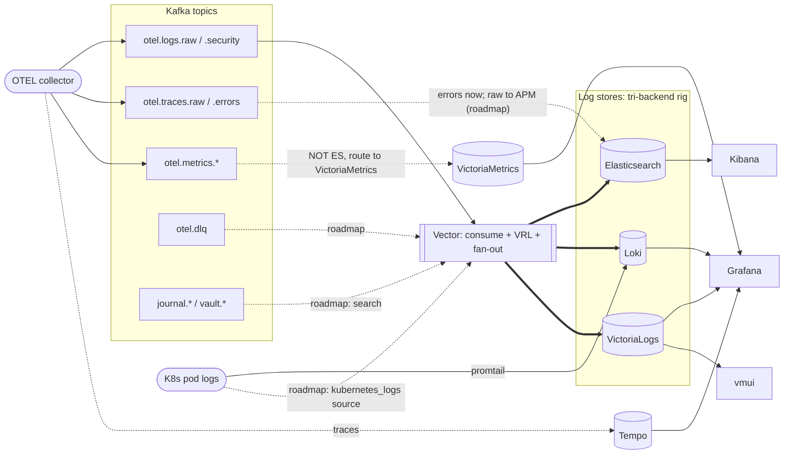

# ADR-053: Observability Data Routing — Multi-Backend Log/Trace/Metric Strategy

**Status**: Accepted
**Date**: 2026-05-28
**Jira**: VW-91 *(internal reference; destination redacted)* · implemented by VW-472 *(internal reference; destination redacted)*, VW-474 *(internal reference; destination redacted)*
**Relates to**: [ADR-013](/adrs/013-llm-observability-migration/) (the OpenLIT→Kafka→Vector→ES migration); evidence in 2026-05-28-Log-Observability-Design-Research *(internal reference; not included)*

---

## Context

ADR-013 established Kafka → Vector → Elasticsearch for LLM observability. In practice the homelab now runs an intentional **multi-backend observability rig**: Ryan uses VictoriaLogs/VictoriaMetrics **and** Elasticsearch at work, and wants hands-on parity at home (overlapping stores are deliberate learning infrastructure, not waste — see memory `user_observability_learning_stack`).

Two recurring questions need a standing answer:
1. **Which signal goes to which backend?** (logs vs traces vs metrics × ES vs Loki vs VictoriaLogs vs VictoriaMetrics vs Tempo)
2. **What are the ingestion field-mapping standards** so every backend gets correct, consistent, non-spoofable data?

This ADR records those decisions. It was prompted by the VictoriaLogs deploy (VW-472) and the discovery that the ES leg had been silently dropping all logs (VW-474), plus an evidence review of best practice.

### Architecture — data routing

Solid arrows = implemented; **thick** = the Vector log fan-out (VW-472/474); dotted = roadmap.

**Reading the diagram**: today the Vector fan-out (thick) feeds all three log stores from `otel.logs.*`; pod logs reach Loki only (the gap); metrics deliberately bypass ES for VictoriaMetrics; the dotted edges are the [roadmap](#roadmap-expansion-candidates-prioritised).

### Signals available on the platform
- **Kafka topics**: `otel.{logs.raw, logs.security, metrics.raw, metrics.slo, traces.raw, traces.errors, dlq}`, `journal.*` (events/sessions/summaries/…), `vault.{file-events, file-tagged}`, SRE + connector topics.
- **K8s pod logs**: collected by promtail → **Loki only** (not in ES).
- **LLM telemetry**: OpenLIT; mcp-bridge token logs (promtail → Loki).
- **Metrics**: Prometheus (scrape) + the `otel.metrics.*` Kafka topics (currently unconsumed).

### Current state at time of writing
- Vector → ES + Loki + **VictoriaLogs** (VW-472) for `otel.logs.raw` + `otel.logs.security`; `otel.traces.errors` → ES.
- ES ingestion fixed (VW-474: data-stream `create` op + `@timestamp`).
- `otel.traces.raw` (~117K) and `otel.metrics.raw` (~66K) have **no consumer**.

---

## Decision

### 1. Routing matrix (signal → backend)

| Signal | Primary store | Secondary (learning/compare) | Rationale |
|---|---|---|---|
| **Application/container logs** | Loki | Elasticsearch + VictoriaLogs | Three log stores in parallel = the learning rig. VictoriaLogs is the lightest (15–30× less disk than ES). |
| **Security/compliance logs** | Elasticsearch | VictoriaLogs | ES retention + RBAC + audit tooling; clamp/forensic timestamps (below). |
| **Distributed traces** | Tempo | Elasticsearch APM (`otel.traces.raw`) | Tempo is the primary; Elastic APM for ES-native trace analysis + draining the backlog. |
| **Metrics** | **VictoriaMetrics / Prometheus** | — | **Metrics do NOT go to Elasticsearch.** ES TSDB exists but is the wrong tool at this scale; route `otel.metrics.*` to VictoriaMetrics. |
| **Search/analytics data** (journal, vault events) | Elasticsearch | — | ES full-text/faceted search complements Qdrant/RAG (keyword vs semantic). |
| **Dead-letter (`otel.dlq`)** | Elasticsearch | — | Need to *see* failed records; small volume, high ops value. |

**Corollary**: the 66K `otel.metrics.raw` backlog is a VictoriaMetrics task, NOT an ELK task. Keep metrics out of the log stores.

### 2. Ingestion field-mapping standards (all log backends)
Grounded in 2026-05-28-Log-Observability-Design-Research *(internal reference; not included)* (VictoriaLogs + Loki docs):
- **Message** (`_msg`/`message`): the human-readable body. **Never JSON-pack the whole record into the message** (kills compression); keep structured fields separate.
- **Timestamp**: use the **original event time** (`timeUnixNano`), not processing time. For ES data streams this is `@timestamp`; for VictoriaLogs it is `_time`.
  - **No-drop**: use infallible VRL conversions with a fallback to ingest time — a malformed event time must never abort the transform and drop the record (audit-log evasion guard, VW-474).
  - **Anti-spoof**: clamp event-supplied time to `[now−90d, now+5m]`; outside that, fall back to ingest time. Retain `vector_processed_at` as the **non-spoofable** forensic timestamp.
- **Stream / label fields**: **low-cardinality, stable producer identity only** (`namespace`, `pod`, `app`, `service`). **`level`/`severity` is a filter field, NOT a stream key.** Never use `trace_id`/`user_id`/`ip` as a stream field (cardinality explosion). High-cardinality values are fine as *regular fields* (especially in VictoriaLogs), just not as stream keys.

### 3. ES writes target data streams with `op_type=create`
`logs-*` are Elasticsearch data streams (built-in `logs` template). Vector elasticsearch sinks MUST set `bulk.action: create` and supply `@timestamp`, or ES rejects with HTTP 400 and Vector drops the event (the VW-474 failure mode).

### 4. Topology pattern
Each new Kafka-sourced signal = a Vector source + a `create`-mode ES data-stream sink (+ optional Loki/VictoriaLogs sinks), reusing the VW-472/VW-474 pattern. Pod logs are the exception — they need a new `kubernetes_logs` source (parallel to promtail), not just a sink.

---

## Consequences

**Positive**
- Clear, repeatable rule for where any new signal goes; no ad-hoc sink sprawl.
- Security/compliance logs are tamper-evident (clamped event time + forensic ingest time) and never silently dropped.
- Metrics stay out of ES → no wasted ES storage/RAM on the wrong tool.
- The three log stores give a genuine ES-vs-Loki-vs-VictoriaLogs comparison.

**Negative / costs**
- Triple-writing logs costs ~3× log storage + ingest CPU. Accepted: it is a *learning* rig, and VictoriaLogs (the added store) is the cheapest of the three.
- Operational surface: 4 stores (ES, Loki, VictoriaLogs, VictoriaMetrics) + Tempo to keep healthy (cf. VW-471 ECK operator pin).
- Field-mapping standards must be applied per-sink in Vector VRL (duplication across transforms).

---

## Alternatives considered
- **Single log backend** (just VictoriaLogs, the most efficient): rejected — defeats the explicit learning/parity goal.
- **Metrics into ES (TSDB mode)**: rejected — VictoriaMetrics/Prometheus are purpose-built and far lighter.
- **OTEL collector direct-to-ES (skip Kafka/Vector)**: rejected — Kafka buffering + Vector fan-out is the established platform pattern (ADR-013) and decouples producers from sink health (the ES outage proved the value of the buffer).

---

## Roadmap (expansion candidates, prioritised)

**Tier 1** (high value, core ELK fit)
1. **K8s pod logs → ES** — *the* gap: real container logs only reach Loki today. New Vector `kubernetes_logs` source → ES `logs-k8s-*`. Makes the 3-way comparison meaningful.
2. **`otel.traces.raw` → Elastic APM** — drains the ~117K backlog; Kibana APM (templates already present). Intentional overlap with Tempo.
3. **`otel.dlq` → ES** — index failed records for debugging.

**Tier 2** (ES search strength)
4. `journal.*` (sessions/summaries) → ES — full-text search over Claude sessions (complements RAG).
5. `vault.file-events` / `file-tagged` → ES — change audit + NER-tag analytics.
6. OpenLIT LLM telemetry → ES — token/cost/latency in Kibana.

**Explicitly excluded from ELK**: `otel.metrics.raw` / `otel.metrics.slo` → route to **VictoriaMetrics** (separate metrics-parity workstream).

Each Tier item should be its own VW issue, implemented off this ADR's standards.
